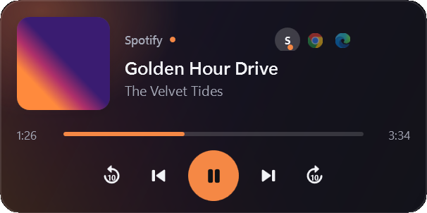
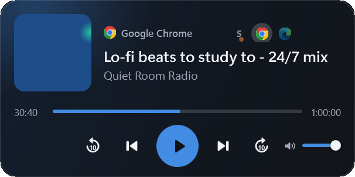
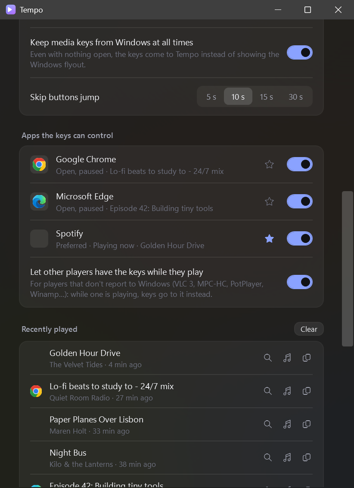
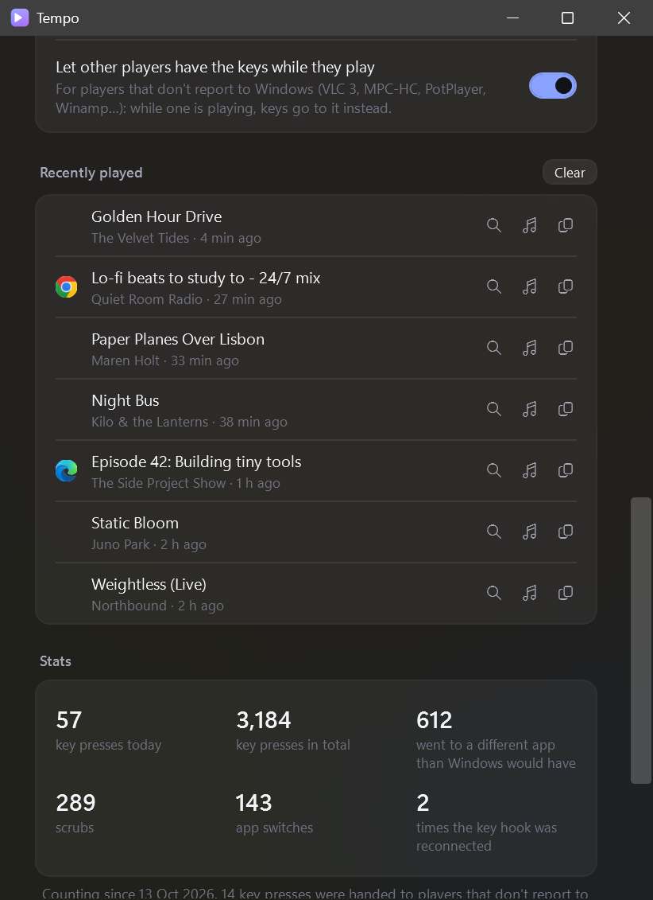

# Tempo

Better media keys for Windows 11. Tempo runs silently in the background (no window, no tray icon) and takes over your keyboard's media keys, so they control the app that's **actually playing**, not whichever paused tab Windows happens to pick. The Windows media flyout is replaced by a small pop-up that shows briefly on each key press.

<p align="center"></p>

## What the keys do

| Key | Tap | Hold | Double-tap |
| --- | --- | --- | --- |
| Play/Pause | play / pause | switch to the next app | bring the playing app to the front |
| Next / Previous | skip track | scrub forward / back (the app follows live) | |
| Stop | stop | | |

## The pop-up

- Artwork, title, artist and a colour taken from the cover
- Drag the seek bar, ±10 s buttons (5/10/15/30 s), per-app volume (or scroll anywhere on the card)
- One icon per app with media: click to switch
- Click the artwork to open the app, the copy button to copy "Artist – Title"
- Right-click: open app, copy song name, prefer this app, hide pop-ups for an hour, settings

| Click an app's icon to switch | Pick which apps get the keys | Recently played and stats |
| --- | --- | --- |
|  |  |  |

<sub>Screenshots use made-up tracks.</sub>

## Which app gets the keys

1. An app you picked (by clicking it or holding Play/Pause), until another app starts playing
2. Otherwise the app that most recently started playing
3. With nothing playing: your preferred app (star it in settings), else the app that played last

Players that don't report to Windows (VLC 3, MPC-HC, PotPlayer, Winamp…) get the keys while they're playing.

## Also

- Recently played list with YouTube / Spotify search and copy buttons
- Stats: key presses, how often Tempo picked a different app than Windows would have
- Checks that its keyboard hook is still alive and reconnects it if Windows drops it
- Updates itself from GitHub releases (verified with SHA-256)

## Install

1. Download `Tempo.exe` from the [latest release](https://github.com/JustSad42/Tempo/releases/latest) and put it in a folder you can write to, e.g. `%LOCALAPPDATA%\Programs\Tempo`. It needs nothing else installed.
2. Run it once. It adds itself to Windows startup and the Start menu. Open **Tempo** from the Start menu any time to get to settings or quit.

Settings, history and stats are stored locally in `%APPDATA%\Tempo`. The only network requests are update checks to GitHub.

## Build

Rust on Windows, no other runtime. The pop-up and settings window are drawn with Direct2D in software, so no graphics driver is loaded.

```powershell
cargo test
cargo build --release                      # target\release\tempo.exe
cargo run -- --snapshot out                # pictures of the pop-up and settings with made-up tracks
cargo run -- --dump sessions.json          # what Windows reports right now
cargo test controls_a_real_session -- --ignored   # end-to-end, against its own media session (run on your desktop)
```

A test copy that can run next to the real one: set `TEMPO_INSTANCE=test` and `TEMPO_DATA_DIR=<folder>`; `TEMPO_NO_HOOK=1` leaves the keyboard alone, `TEMPO_TEST_CRASH_AFTER=<seconds>` checks the restart.

| File | What |
|---|---|
| `main.rs`, `app.rs` | events, state, what each key and click does |
| `logic.rs` | which app, key gestures, playback position (no Windows calls) |
| `media.rs`, `apps.rs` | Windows media sessions, app names, icons, volume |
| `hook.rs` | keyboard hook, its watchdog, players Windows can't see |
| `popup.rs`, `settings_ui.rs`, `gfx.rs` | the two windows and drawing |
| `config.rs`, `updater.rs`, `supervisor.rs`, `system.rs` | files, self-update, crash restart, Windows helpers |

Version 2 is the Rust rewrite of the C# app. It reads the same settings, history and stats, and installed 1.x copies update to it like to any other release. Two things differ: screen readers can't read the settings window (it is drawn by the app; it works fully from the keyboard), and a crash leaves a line in `%APPDATA%\Tempo\log.txt` instead of a dump file.
